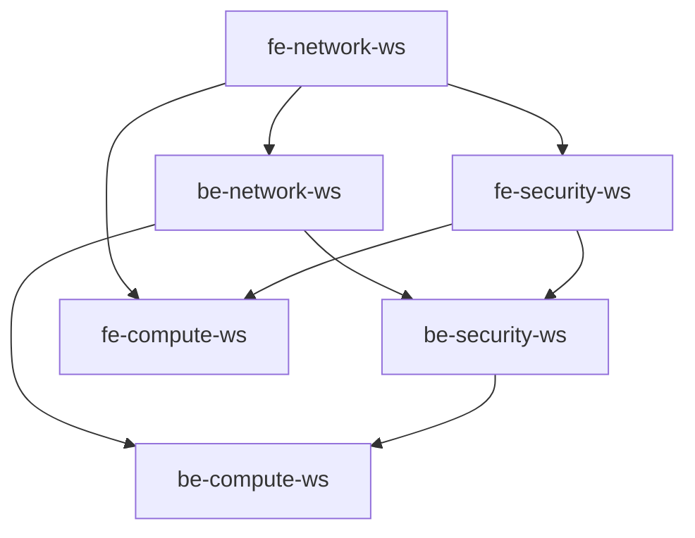

# AWS Intra-Region VPC Peering Architecture (Assignment-02)

This repository contains the Terraform infrastructure code for the **Intra-Region VPC Peering Assignment** deployed on **AWS (Singapore `ap-southeast-1`)** using **HCP Terraform (Terraform Cloud)** micro-workspaces.

---

## 1. Architecture Overview


---

## 2. HCP Terraform Micro-Workspaces Architecture

The codebase is modularized into **6 decoupled workspaces** in HCP Terraform (Terraform Cloud) to enable isolation of network, security, and compute layers:

```text
vpc-peering-assignment/
├── common/
│   └── providers.tf         # Shared AWS Provider config (symlinked into all workspaces)
├── fe-network-ws/           # 1. Frontend VPC, Subnets, IGW, NAT GW & Route Tables
├── be-network-ws/           # 2. Backend VPC, Subnets, IGW, NAT GW, Peering & Routes
├── fe-security-ws/          # 3. Frontend Security Groups & Internal Rules
├── be-security-ws/          # 4. Backend Security Groups & Cross-Peering Security Rules
├── fe-compute-ws/           # 5. Frontend Bastion + Private Instances + Key Pair
├── be-compute-ws/           # 6. Backend Bastion + Private Instances + Key Pair
├── deploy_all.sh            # One-click deployment script (Order: 1 -> 6)
├── destroy_all.sh           # One-click teardown script (Order: 6 -> 1)
├── fe-key.pem               # SSH Private Key for Frontend Instances
└── be-key.pem               # SSH Private Key for Backend Instances
```

### Remote State Dependency Graph



---

## 3. Security Groups & Traffic Rules Matrix

All security rules are implemented using modern standalone resources (`aws_vpc_security_group_ingress_rule` and `aws_vpc_security_group_egress_rule`) with Security Group referencing (`referenced_security_group_id`):

| Security Group       | Inbound Rules                                                                                                    | Outbound Rules                                                            |
| :------------------- | :--------------------------------------------------------------------------------------------------------------- | :------------------------------------------------------------------------ |
| **`fe: pub-sgp-01`** | • Allow Your IP to Ping (ICMP Type 8 Code 0)<br>• Allow Your IP to SSH (TCP 22)                                  | • Allow ALL Types of traffic to `0.0.0.0/0`                               |
| **`fe: pri-sgp-01`** | • Allow Only `pub-sgp-01` to Ping<br>• Allow Only `pub-sgp-01` to SSH                                            | • Allow ALL Types of traffic to `0.0.0.0/0`                               |
| **`fe: pri-sgp-02`** | • Allow Only FROM `fe: pri-sgp-01` to Ping & SSH<br>• Allow Only FROM `be: pri-sgp-02` (Cross-VPC) to Ping & SSH | • Allow to Ping TO `be: pri-sgp-02`<br>• Allow to SSH TO `be: pri-sgp-02` |
| **`fe: pri-sgp-03`** | • Allow Only FROM `fe: pri-sgp-01` to Ping & SSH<br>• Allow Only FROM `be: pri-sgp-03` (Cross-VPC) to Ping & SSH | • Allow to Ping TO `be: pri-sgp-03`<br>• Allow to SSH TO `be: pri-sgp-03` |
| **`be: pub-sgp-01`** | • Allow Your IP to Ping (ICMP Type 8 Code 0)<br>• Allow Your IP to SSH (TCP 22)                                  | • Allow ALL Types of traffic to `0.0.0.0/0`                               |
| **`be: pri-sgp-01`** | • Allow Only `pub-sgp-01` to Ping<br>• Allow Only `pub-sgp-01` to SSH                                            | • Allow ALL Types of traffic to `0.0.0.0/0`                               |
| **`be: pri-sgp-02`** | • Allow Only FROM `be: pri-sgp-01` to Ping & SSH<br>• Allow Only FROM `fe: pri-sgp-02` (Cross-VPC) to Ping & SSH | • Allow to Ping TO `fe: pri-sgp-02`<br>• Allow to SSH TO `fe: pri-sgp-02` |
| **`be: pri-sgp-03`** | • Allow Only FROM `be: pri-sgp-01` to Ping & SSH<br>• Allow Only FROM `fe: pri-sgp-03` (Cross-VPC) to Ping & SSH | • Allow to Ping TO `fe: pri-sgp-03`<br>• Allow to SSH TO `fe: pri-sgp-03` |

---

## 4. Deployment Instructions

### Method A: Automated Script

```bash
# 1. Deploy all workspaces in sequence (1 -> 6)
./deploy_all.sh

# 2. Destroy all workspaces when done (6 -> 1)
./destroy_all.sh
```

### Method B: Manual Step-by-Step Deployment

```bash
# Step 1: Frontend Network
cd fe-network-ws && terraform init && terraform apply -auto-approve && cd ..

# Step 2: Backend Network (includes Peering)
cd be-network-ws && terraform init && terraform apply -auto-approve && cd ..

# Step 3: Frontend Security Groups
cd fe-security-ws && terraform init && terraform apply -auto-approve && cd ..

# Step 4: Backend Security Groups (includes Cross-peering rules)
cd be-security-ws && terraform init && terraform apply -auto-approve && cd ..

# Step 5: Frontend Compute (Bastion + Private Instances)
cd fe-compute-ws && terraform init && terraform apply -auto-approve && cd ..

# Step 6: Backend Compute (Bastion + Private Instances)
cd be-compute-ws && terraform init && terraform apply -auto-approve && cd ..
```

---
